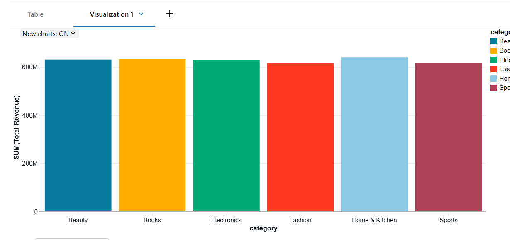
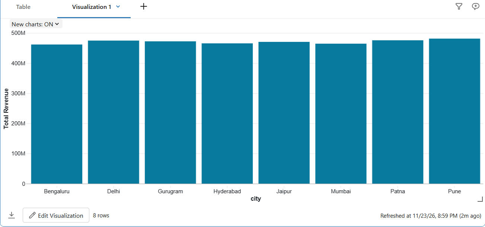
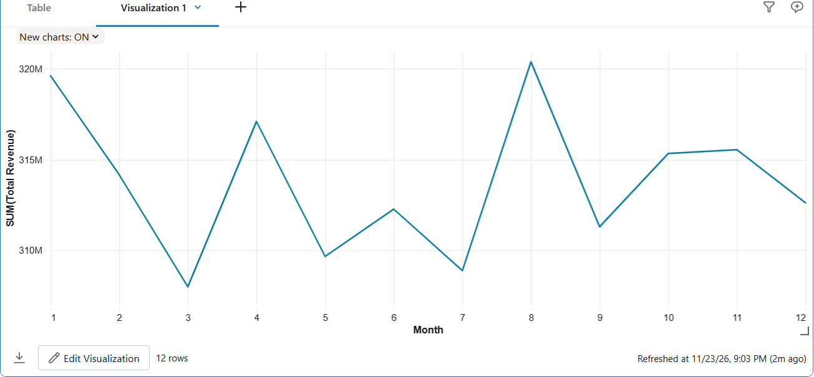

# E-Commerce Big Data Analytics using Apache Spark

## Project Overview
This project analyzes 100,000 e-commerce order records using Apache Spark and PySpark on Databricks.

The objective is to extract meaningful business insights through large-scale data processing, data cleaning, Spark SQL, and data visualization.

## Objectives
- Analyze e-commerce sales data.
- Clean and transform raw datasets.
- Calculate total and average revenue.
- Identify top-performing product categories.
- Analyze city-wise and monthly sales.
- Examine order statuses.
- Visualize business insights.

## Dataset Description
- Dataset: ecommerce_data.csv
- Total Records: 100,000
- Total Columns: 10

### Dataset Columns
order_id, order_date, customer_id, product, category, city, quantity, unit_price, payment_method, order_status

## Technologies Used
- Databricks
- Apache Spark 4.2.0
- PySpark
- Spark SQL
- Python
- GitHub

## Implementation Workflow
1. Dataset Upload
2. Data Loading using Spark
3. Data Cleaning
4. Revenue Calculation
5. Category-wise Analysis
6. City-wise Analysis
7. Monthly Sales Analysis
8. Top 10 Products Analysis
9. Order Status Analysis
10. Spark SQL Queries
11. Data Visualization

## Key Findings
- Total Orders: 100,000
- Highest Revenue Category: Home & Kitchen
- Highest Revenue City: Pune
- Highest Revenue Month: August
- Top Revenue Product: Shoes

## Apache Spark Concepts Used
- Spark DataFrame API
- Data Cleaning and Transformation
- GroupBy and Aggregation
- Spark SQL
- Data Processing

## Project Structure
ecommerce-big-data-analytics/
├── README.md
├── notebooks/
├── dataset/
├── reports/
└── screenshots/

## Conclusion
This project demonstrates how Apache Spark can process and analyze large e-commerce datasets to generate useful business insights.

## Author
Bishnu Kumar

B.Tech CSE (AI & ML)
## Project Visualizations

### Category Revenue

### City Revenue

### Monthly Revenue

